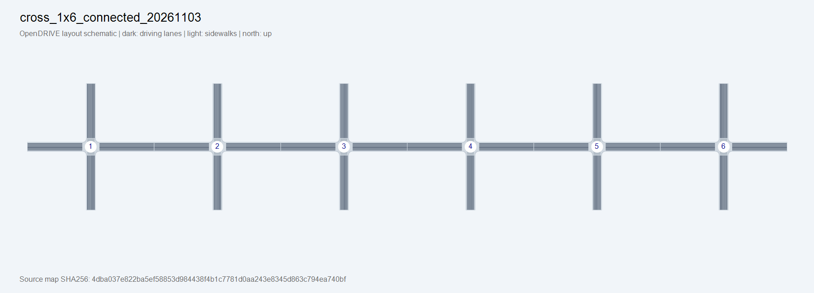

# Map layout

Generated from this directory's map.xodr. North is up; dark bands are driving lanes and light bands are sidewalks. Numbers identify manifest junction entries. This is a static geometry diagram, not a CARLA rendering or additional driving acceptance. Existing overview.png/street.png files, where present, are CARLA screenshots.
